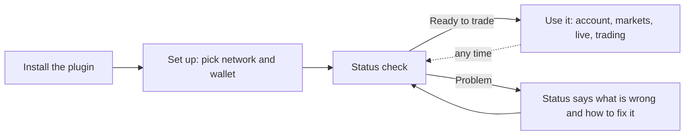

# Pod plugin: product design

*Draft 3, 2026-11-26. Earlier drafts are in [archive](file:///Users/sabpap/Workspace/Clients/Laurium/pod-ai/specs/archive/).*

## What the product is

A Claude plugin that lets an AI work on pod network with a funded wallet: connect the wallet, check that it can act, see its account and any other account, read markets, follow live updates, and trade. The user is a human working through an AI assistant, or an agent working alone. How well the AI trades is the user's business; the plugin gives it a complete, correct way to read and act.

The plugin is made of **skills** (the manual: which pod request to make for each goal and how to read the answer) and a small amount of **setup state** (which network and which wallet). The prototype makes plain REST, WebSocket and JSON-RPC calls. A CLI can wrap the same calls later.

## Scope

**In:** setup, connection status, the connected account and any other account, trading on pod, market data, live updates.

**Out for now:** bot keys (delegation), deposits, withdrawals, transfers between pod accounts, account recovery, test-money minting, admin functions (creating or closing markets), the multisig contract. The wallet is already funded and the plugin only operates inside pod.

**Network:** pod staging testnet (chain id 129302) only. The setup stores the network, so mainnet can be added later without changing the skills.

## The user's journey

---

## Section 1. Setup

Connects the plugin to a network and a wallet, once.

**What setup does:**

1. Picks the network (staging today) and checks it answers.
2. Picks the wallet. The first and only wallet type for now is the **dev wallet**: a Foundry keystore made with `exotic-dev`, whose password sits in the macOS Keychain. Setup lists the keystores it finds and the user picks one.
3. Reads the wallet's address from the keystore.
4. Saves the **profile**: the network, the wallet type, the keystore name and the address. The profile never holds the private key or the password. There is **one profile at a time**.
5. Sends **one real test transaction**: a tiny maker-only order far from the current price, cancelled straight away. This proves the account can really send: no region block, no blacklist, transaction numbers working. The result and its time are saved in the profile.
6. Runs the status check (Section 2) and shows the result.

**Other setup actions:** show the current profile; re-run the test transaction; disconnect (delete the profile). To use another wallet, disconnect and set up again.

**Wallet-neutral by design.** Every other section talks to the wallet through four questions only: *what is your address*, *what kind of wallet are you*, *sign this message*, *sign this transaction*. The dev wallet answers them with Foundry's `cast`. A browser, hardware or email-login wallet can be added later by answering the same four questions.

## Section 2. Status

Answers one question: **can the AI act right now, and if not, why not?** Can be run at any time, and the other sections can run it first.

**The status levels:**

| Level | Meaning |
|---|---|
| **Not set up** | No profile exists |
| **Set up** | A profile exists, but the network or the wallet has not been checked |
| **Connected, read-only** | The network answers and the address is known, but the wallet cannot sign or the account cannot pay |
| **Ready to trade** | Every check below passed |
| **Problem** | A check failed; status names it and says how to fix it |

**The checks, in order:**

| # | Check | How | Fails when |
|---|---|---|---|
| 1 | Profile exists | Read the saved profile | Setup was never run |
| 2 | Network answers | `GET /v1/clob/status` | Timeout or error |
| 3 | Right network | `eth_chainId` returns `0x1f916` | Another chain answered |
| 4 | Network open for writes | `pod_status`: `read_only` and `paused` are false | Pod is paused or read-only |
| 5 | Wallet can sign as this address | Ask the wallet to sign a test message, then check the signature belongs to the profile's address. Free, nothing is sent | Keystore missing, password missing, address mismatch |
| 6 | Account is funded | `GET /v1/clob/balances/{address}`: cash above zero (cash also pays pod's tiny transaction fee) | Zero cash |
| 7 | Account is not stuck | `pod_getAccountDiagnostics`: not locked, no stuck transaction; `GET /v1/accounts/{address}/nonce-slots` has free slots | Locked or stuck account |
| 8 | Has really transacted | The saved result of setup's test transaction. Status does not send anything itself | The test failed (region block `-32025`, blacklist, any send error), or it was never run |

**What status shows:** the level, the network, the address, cash and withdrawable cash, number of open positions and open orders, when the test transaction last passed, and for a problem, the failed check with its fix.

## Section 3. Account

Everything about an account. **The connected account is the default**; any other address can be named instead. Reading needs no key, so other accounts work the same way, read-only.

| Goal | Call | Interface |
|---|---|---|
| Overview: account value, cash, withdrawable, profit, leverage | `GET /v1/clob/positions/{account}` plus `/balances/{account}` | REST |
| Cash and spot tokens | `GET /v1/clob/balances/{account}` | REST |
| Open positions | `GET /v1/clob/positions/{account}` | REST |
| Orders: open, or history by status or market | `GET /v1/clob/orders/{account}` | REST |
| Trades | `GET /v1/clob/fills/{account}` | REST |
| Armed stop-loss and take-profit triggers | `GET /v1/clob/triggers/{account}` | REST |
| Everything that happened (orders, fills, transfers, forced closes) | `GET /v1/clob/activity/{account}` | REST |
| Forced closes into the backstop | `GET /v1/clob/backstop-transfers/{account}` | REST |

Other accounts can be saved under a name ("whale"), so the AI can say "show whale's positions".

## Section 4. Trading

Every trading action pod allows for the connected account. All are signed transactions to pod's orderbook contract, sent through JSON-RPC. Only the connected account can trade.

| Action | Contract function |
|---|---|
| Place an order: limit or market; optional maker-only, immediate-or-cancel, reduce-only | `submitOrder` |
| Edit an order's price or size | `update` |
| Cancel an order | `cancel` |
| Place, edit or cancel a stop-loss or take-profit | `submitTrigger`, `updateTrigger`, `cancelTrigger` |
| Up to 64 actions at once (for example entry plus stop plus target, or cancel everything) | `submitBatch` |

**Every trading action follows the same steps.** The skill explains each one:

1. Run the status check if it has not run recently; stop unless "Ready to trade".
2. Read the market's rules (Section 5): round price and size to its steps, check the minimum order value.
3. Convert numbers to pod's format: amounts and prices × 10^18.
4. Set the deadline on the 500 ms grid, in microseconds.
5. Get a free transaction number (nonce).
6. Encode the call and have the wallet sign it.
7. Send it with `eth_sendRawTransaction`.
8. Confirm it was accepted: `pod_getTxStatus`.
9. Confirm the real outcome at the next auction round: `GET /v1/clob/orders/{address}` and `/fills`. Accepted does not mean filled.

**Dry run:** every action can stop after step 6 and show exactly what would be sent.

## Section 5. Market data

What is traded and at what price. No key needed. Specified and built: [06-market-data.md](file:///Users/sabpap/Workspace/Clients/Laurium/pod-ai/specs/06-market-data.md).

| Goal | Call | Interface |
|---|---|---|
| Every market and its rules: spot or perp, status, max leverage, fees, price step, size step, minimum order value | `GET /v1/clob/markets` | REST |
| Find a market by name ("nvidia", "sk hynix") | Same list, matched on name and ticker | REST |
| Live numbers per market: last price, mark, oracle, 24-hour change, high, low, volume, funding, open interest | `GET /v1/clob/markets/stats` | REST |
| Order book | `GET /v1/clob/orderbook/{id}` | REST |
| Price history bars, 1 minute to 1 month | `GET /v1/clob/candles/{id}` | REST |
| Per-round history of mark, oracle, funding, open interest, volume | `GET /v1/clob/solutions` | REST |

## Section 6. Live updates

Follow markets and accounts as they change. Account channels default to the connected account and accept any address. Specified and built: [07-live.md](file:///Users/sabpap/Workspace/Clients/Laurium/pod-ai/specs/07-live.md).

| What to follow | Channel |
|---|---|
| Market stats and status changes | `pod_markets` |
| Order book | `pod_orderbook` |
| The price bar being formed | `pod_candles` |
| Orders of up to 64 accounts | `pod_orders_v2` |
| One account's activity | `pod_activity` |
| One account's positions | `pod_positions` |
| One account's triggers | `pod_triggers` |
| Receipts of sent transactions | `pod_receipts` |
| Each new auction round | `newHeads` |

The skill explains subscribing (`eth_subscribe`), catching up without gaps (read REST first, then subscribe with `since = solution_now`), the 2.3-hour replay limit, and resuming when the server closes a stream.

**The plugin ships a listener** (decided 2026-11-26, replacing "manual only"): Claude Code runs it as a background process that wakes the agent on its output, with simple conditions such as "mark < 140". The skill still documents the protocol for harnesses that want their own listener.

## Section 7. Network activity

What is happening on pod as a whole. No key needed. Added after the usage scenarios showed questions such as "how many transactions in the last second?".

| Goal | Call | Interface |
|---|---|---|
| Latest auction round number | `eth_blockNumber` | JSON-RPC |
| One round: time and its transactions (one round = one "block", two per second) | `eth_getBlockByNumber` | JSON-RPC |
| Recent transactions with their decoded function (last 1,000 only) | `GET /v1/transactions` | REST |
| One transaction in full | `GET /v1/tx/{hash}` | REST |
| Current round time | `GET /v1/clob/status` | REST |
| Each new round as it happens | `newHeads` | WebSocket |

Checked live on 2026-11-26: the last six rounds held 0 or 1 transaction each, about 2 per second. Recent transactions were split between traders' `submitBatch` calls and the solver's `submitSolutionsV5` (the auction result for each round).

## Shared reference (not a user-facing section)

One reference that every skill points to: network addresses, identifiers, 10^18 numbers in hex or decimal, microseconds against seconds, the `timestamp` freshness parameter, the six paging styles, error codes, and the auction cycle.

## Skills, as the user sees them

Four skills (revised 2026-11-26, version 0.6.0; the main skill was named `pod` until 0.6.1). A skill is split off only when the user will type its name; everything the user says in words goes through one main skill, `/pod:use`, which reads a reference file for each kind of request. The earlier seven-skill version is at git tag `hybrid-original`.

| Skill | Section | Typical requests |
|---|---|---|
| `/pod:use` (main skill, started by the agent or the user) | 3 to 6 | "What do I have?", "show 0xABC…'s positions", "top movers", "NVDA order book", "buy 0.5 NVDA at 180", "cancel all my orders", "watch my positions" |
| `/pod:setup` | 1 | "Connect my wallet", "re-test my wallet", "disconnect" |
| `/pod:status` | 2 | "Am I connected?", "can you trade?" |
| `/pod:settings` (started only by the user) | 4 | `/pod:settings approval auto`, `/pod:settings market_band_pct 1` |

The main skill's references are `account.md` (Section 3), `trade.md` (Section 4), `markets.md` (Section 5) and `live.md` (Section 6). Network activity (Section 7) is not built yet.

`/pod:settings` sets `disable-model-invocation: true`, so the agent cannot start it. The agent may show the settings and, when the user asks for that exact change, set `approval ask`, `market_band_pct` or `default_ttl` itself; switching `approval` to `auto` is always the user's own action. This is guidance to the agent, not a lock: the scripts would accept the change from the agent.

**Awareness on demand.** There is no session-start hook (decided 2026-11-26). The agent learns the level, the address, the cash and what it can do by running `status.sh` (the `/pod:status` skill), which the main skill runs first when the state is unknown.

## How it will be used

Hypothetical requests, to check the design covers them. Each row says what the plugin provides and what the AI or its harness brings.

| The user says | The plugin provides | The AI or harness brings |
|---|---|---|
| "Are we connected?" | `/pod:status`: "Ready to trade, address 0x035A…, $100 cash, 0 positions", and what the agent can and cannot do | Nothing |
| "What's our balance?" | Account section, connected account by default: cash, withdrawable, account value, profit | Nothing |
| "What's X's balance?" | Same calls with X's address, or X's saved name | Nothing |
| "How many transactions on the network in the last second?" | Network section: read the last two rounds with `eth_getBlockByNumber` and count their transactions | Nothing |
| "How is market Z going?" | Market data: 24-hour change, high, low, volume, funding, open interest, recent price bars, order book spread | The judgement of what "going well" means |
| "What's the current price?" | Market data: last traded price, mark price and oracle price, and what each one means | Which one to quote |
| "Watch Y for the next 2 hours and if this happens, do that" | A listener on Y with `--for 2h --until "<condition>"`, run in the background, which wakes the agent when the condition holds; then the trading actions. For a stop-loss or take-profit on a position, a pod trigger does the watching on pod itself, with no listener | Deciding the condition, and the session staying open for 2 hours |
| "Read the news and trade on your own" | Everything after the decision: find the market, check buying power, place orders, confirm the outcome, follow the position | Reading the news (pod's API has none), deciding what to trade, and the autonomy to act |

## Decisions

| # | Question | Decision (2026-11-26) |
|---|---|---|
| D1 | How does the plugin prove the wallet can really transact? | Every status check signs a free test message. Setup sends one real test transaction (tiny maker-only order, cancelled at once); status reports its saved result |
| D2 | Transfers between pod accounts? | Out for now |
| D3 | How many wallets? | One profile at a time; disconnect to change |
| D4 | Live updates without a long-running process? | ~~Manual only~~. Revised 2026-11-26: the plugin ships a listener that the harness runs in the background, with simple conditions; the protocol stays documented for other harnesses ([07-live.md](file:///Users/sabpap/Workspace/Clients/Laurium/pod-ai/specs/07-live.md) L1) |
