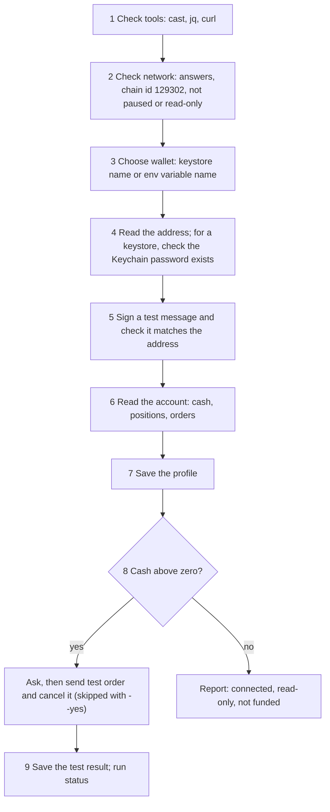

# Section 1: Setup

*Spec, 2026-11-26. Decided in the interview of 2026-11-26. Part of [01-plugin-design.md](file:///Users/sabpap/Workspace/Clients/Laurium/pod-ai/specs/01-plugin-design.md).*

Setup connects the `pod` plugin to pod staging and to one funded wallet, proves the wallet can really send, and saves the result as the profile every other section reads.

## Decisions

| # | Topic | Decision |
|---|---|---|
| S1 | How setup runs | A skill (the manual) plus small scripts shipped in the plugin for the fiddly parts: reading the wallet, signing, the test transaction |
| S2 | Script language | Bash, with Foundry's `cast` for encoding and signing, `curl` for pod's API, `jq` for JSON |
| S3 | Wallet types | Two: a **Foundry keystore** whose password is in the macOS Keychain (normal path), and a **private key in an environment variable** (fallback for servers and CI) |
| S4 | Private key source | Environment variable only. The profile stores the variable's name, never the key |
| S5 | Keystore without a Keychain password | Setup stops and shows the command that stores the password. An agent never sees or types a password |
| S6 | Profile location | User level: `~/.config/pod-plugin/profile.json`. One profile at a time, shared by every project and session on the machine |
| S7 | Who starts setup | The user with `/pod:setup`, or an agent itself by naming the wallet, so an autonomous agent can connect without a human |
| S8 | Test transaction | Setup asks the user to **approve or deny** it: the AskUserQuestion tool with two options only, "Approve" and "Deny"; anything but Approve sends nothing. A `--yes` flag skips the question for autonomous agents |
| S9 | Networks | Pod staging only. Every script checks the chain id is 129302 before sending and refuses anything else |
| S10 | Missing tools | Setup checks for `cast`, `jq` and `curl` first and stops with the install command (`brew install foundry jq`) |
| S11 | Plugin name | `pod`, so the commands are `/pod:setup`, `/pod:status` and so on |
| S12 | Distribution | The pod-ai folder becomes a git repo that is also a local plugin marketplace, installed with `/plugin` |

## What setup does, step by step



1. **Tools.** `cast`, `jq`, `curl` must be on the path. If one is missing: stop, show `brew install foundry jq`.
2. **Network.** `GET /v1/clob/status` answers; `eth_chainId` is `0x1f916`; `pod_status` has `read_only` and `paused` false.
3. **Wallet choice.**
   - Keystore: list `~/.foundry/keystores`; the user picks, or the agent names one.
   - Env variable: the user or agent names the variable (default `POD_PRIVATE_KEY`); setup checks it is set.
4. **Address.** Keystore: confirm the Keychain holds a password (service `foundry-keystore`, account = keystore name), then `cast wallet address --account <name>`. Env variable: `cast wallet address --private-key` from the variable. The password and key reach `cast` through a private temp file or the environment, never the command line.
5. **Signing check.** `cast wallet sign` a fixed message, then `cast wallet verify` against the address. Free; nothing is sent.
6. **Account.** `GET /v1/clob/balances/{address}`, `/positions/{address}`, `/orders/{address}?status=active`.
7. **Save the profile** (below), with the test result still empty.
8. **Test transaction**, only when cash is above zero:
   - Market: NVDA perp (active, the most traded). Falls back to the first active perp.
   - Order: buy, maker-only (post-only), the smallest size the market allows, at half the best bid, rounded to the price step. It cannot fill.
   - Ask the user to approve or deny it (two options only), unless `--yes`.
   - Send `submitOrder`, wait for `pod_getTxStatus` to say finalized, check the order is `active` in `/v1/clob/orders`, then send `cancel` and check it is `canceled`.
   - Any send error is reported in plain words, including `-32025` (region blocked) and "blacklisted".
9. **Save the test result** (passed or failed, time, both transaction hashes) and run the status check.

## The profile

`~/.config/pod-plugin/profile.json`, readable only by the user (permissions 600):

```json
{
  "version": 1,
  "network": {
    "name": "staging",
    "chain_id": 129302,
    "rest": "https://staging-rpc.podtestnet.dev/v1",
    "rpc": "https://staging-rpc.podtestnet.dev",
    "ws": "wss://staging-rpc.podtestnet.dev"
  },
  "wallet": {
    "type": "keystore",
    "keystore": "exotic-test-1",
    "env_var": null,
    "address": "0x035A9E2f3ED8bAAD656E66BF3f0071da40DcDa70"
  },
  "connected_at": "2026-11-26T15:00:00Z",
  "test_transaction": {
    "result": "passed",
    "at": "2026-11-26T15:00:05Z",
    "market": "NVDA/USD",
    "order_tx": "0x…",
    "cancel_tx": "0x…",
    "error": null
  }
}
```

For the env-variable wallet, `type` is `env`, `keystore` is null and `env_var` holds the variable's name.

## Other setup actions

| Action | What it does |
|---|---|
| Show | Prints the profile in plain words |
| Re-test | Runs step 8 again and saves the new result |
| Disconnect | Deletes the profile. Never touches the keystore, the Keychain or the variable |

To use another wallet: disconnect, then set up again.

## Scripts

All in the plugin's `scripts/` folder, Bash, each printing one JSON object so the agent can read the result.

| Script | Job |
|---|---|
| `check-tools.sh` | Steps 1: tools present, with install command if not |
| `check-network.sh` | Step 2 |
| `list-wallets.sh` | Step 3: keystores found, and whether each has a Keychain password |
| `wallet.sh` | The wallet contract used by every section: `address`, `type`, `sign-message`, `sign-tx`. Hides whether the key comes from a keystore or a variable |
| `profile.sh` | Read, write, show and delete the profile |
| `test-transaction.sh` | Step 8, with `--yes` and `--dry-run` |
| `setup.sh` | Runs steps 1 to 9 in order, for an agent that wants it done in one call |

## Error messages

Every failure names the step, says what is wrong in plain words, and gives the fix.

| Failure | Message |
|---|---|
| Tool missing | "cast is not installed. Run: brew install foundry" |
| Network down | "Pod staging does not answer at https://staging-rpc.podtestnet.dev. Try again later." |
| Wrong chain | "The network answered with chain id X, not pod staging (129302). Nothing was sent." |
| Pod paused | "Pod is paused or read-only right now, so nothing can be sent. Reading still works." |
| No Keychain password | "The keystore <name> has no password in the Keychain. Run: security add-generic-password -s foundry-keystore -a <name> -w" |
| Env variable empty | "The variable POD_PRIVATE_KEY is not set in this session." |
| Signature mismatch | "The wallet signed as 0xB…, not 0xA…. The profile was not saved." |
| Not funded | "Connected, read-only: the account has no cash on pod, so it cannot trade." |
| Region blocked | "Pod refused the test order: not available in your region (-32025)." |

## Implementation notes (2026-11-26)

Built in [plugins/pod](file:///Users/sabpap/Workspace/Clients/Laurium/pod-ai/plugins/pod/): the `/pod:setup` skill, the scripts listed above plus `lib.sh` (shared helpers), and [tests/smoke.sh](file:///Users/sabpap/Workspace/Clients/Laurium/pod-ai/plugins/pod/tests/smoke.sh) (13 read-only checks, all passing). The plugin validates with `claude plugin validate`.

What the build changed or found:

| Finding | Effect |
|---|---|
| Foundry keystores do not store the address in clear | `list-wallets.sh` shows the address as null; `wallet.sh address` decrypts the keystore with its Keychain password to get it |
| `cast` cannot read a raw private key from an environment variable | For the env-variable wallet, the key is passed to `cast` as an argument, so this user's own processes can see it while `cast` runs. Acceptable for the server/CI fallback; the keystore path has no such exposure |
| An order joins the auction round at its deadline (`included_batch` = `deadline` on live orders) | The test order uses a 5-second deadline instead of exotic-dev's 60 seconds, so the test takes about 15 seconds. Set with `POD_TEST_LAG_S` |
| A Claude agent cannot answer an interactive prompt inside a script | "Ask first" (S8) works by setup stopping with `needs_approval` and the plan; the agent asks the user to approve or deny, and runs `test-transaction.sh --yes` only on approve |
| The test price is half the oracle price, not half the best bid | The oracle is always present; a maker-only buy there cannot cross a real ask, and if it would, pod refuses it rather than trade |
| Status is Section 2, not built yet | Setup's final answer carries the level and account summary itself |

## First-user test (2026-11-26)

The `pod-ai-user` session installed and set up the plugin from nothing, given only "install the pod plugin from the local marketplace and set it up with our dev wallet". It reached **ready to trade**: it found `exotic-test-1` alone, ran setup, asked the user before the test transaction, and the order rested and was cancelled.

| Friction | Cause | Response |
|---|---|---|
| The agent could add the marketplace but not run `claude plugin install`; the user had to | Claude Code's auto mode blocks an agent from installing plugins | Installing is a person's job. The README says so |
| `/pod:setup` was missing until a new session started | Skills load at session start | The README says to start a new session after installing |
| The agent ran the scripts directly in the first session | The skill was not loaded yet | No change: the scripts work on their own |

## Not part of setup

Creating wallets, funding them, several profiles, mainnet, bot keys.
