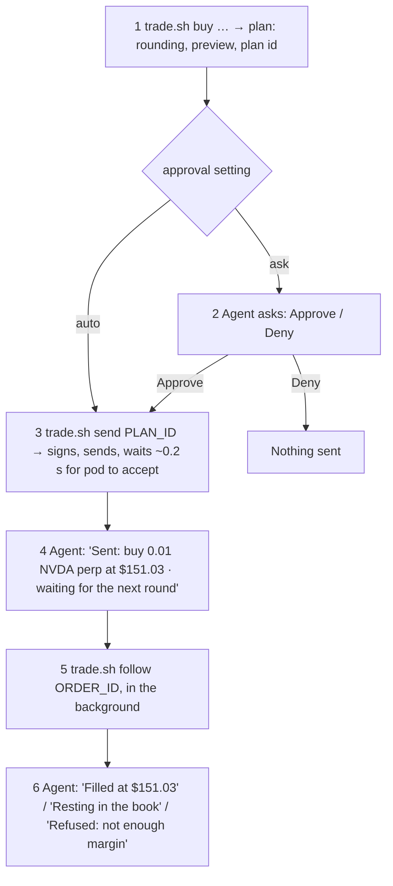

# Section 4: Trading

*Spec, 2026-11-26. Decided in the interview of 2026-11-26. Part of [01-plugin-design.md](file:///Users/sabpap/Workspace/Clients/Laurium/pod-ai/specs/01-plugin-design.md).*

Trading places, changes and cancels orders and stop-loss / take-profit triggers for the **connected wallet**, on pod staging only. It is the first section that sends transactions. How the agent decides what to trade is the user's business; the plugin makes each action correct, previewed and traceable.

## Decisions

| # | Topic | Decision |
|---|---|---|
| TR1 | Approval | A profile setting, `approval`: **`ask`** (default) shows a preview and an Approve / Deny question before every send; **`auto`** sends without asking, for autonomous agents. Changed with `/pod:setup` |
| TR2 | Prices and sizes between the market's steps | **Round to the safe side and say so**: a buy price goes down, a sell price up, a size down. The preview shows each change, e.g. "151.034 → 151.03" |
| TR3 | Worst price for a market order | **2% from the mark price** unless the order names its own cap or band. The default band is a profile setting, `market_band_pct` |
| TR4 | Reporting the outcome | **"Sent" at once, the result from the background**: the agent reports the send straight away, keeps following the order, and reports filled / resting / refused when the auction round settles. The user can keep talking meanwhile |
| TR5 | Preview | **Cost and margin**: market, side, size, price after rounding, worst price (market orders), order value, fee, margin needed, free margin after |
| TR6 | How long a limit order rests | **1 day** by default; any order can name its own time (`10m`, `1h`, `7d`). A profile setting, `default_ttl` |
| TR7 | Shortcuts | **Close a position** (all or part, one reduce-only order) and **cancel all orders** (all, or one market's, in one batch). No bracket orders and no free-form batches for now |
| T5 (status) | Check before each send | None: pod's own error is the signal, and every send's result is recorded for status |

## Actions

| Action | What it does | Pod call on the order book contract `0x50d0…0002` |
|---|---|---|
| `buy` / `sell` | Limit order, or market order with `--market` | `submitOrder(bytes32,int256,uint256,uint8,uint128,uint128,uint8)` |
| `edit` | Change a resting order's price and/or size | `update(bytes32,bytes32,uint256,uint256,address,uint128)` |
| `cancel` | Cancel one order | `cancel(bytes32,bytes32,uint128)` |
| `stop-loss` / `take-profit` | Arm a trigger on a position | `submitTrigger(bytes32,int256,uint256,uint256,uint8,uint8,uint128,uint128,bool,bool)` |
| `edit-trigger` | Change a trigger's size, trigger price or limit price | `updateTrigger(bytes32,bytes32,int256,uint256,uint256,uint128)` |
| `cancel-trigger` | Remove a trigger | `cancelTrigger(bytes32,bytes32,uint128)` |
| `close` | Close a perp position, all or a percentage | `submitOrder` with reduce-only, at market with the band (TR3) unless a price is given |
| `cancel-all` | Cancel every open order, or one market's | `submitBatch(bytes[])` of `cancel` calls, up to 64 per batch |

Order options: `--price P` (limit), `--market` with optional `--max-price` / `--min-price` or `--band 1.5`, `--maker-only`, `--ioc`, `--reduce-only`, `--rests 1h`. Trigger options: `--trigger-price`, `--limit-price` (else at market with the band), `--size` (else the whole position).

## How one send works

1. **Plan.** `trade.sh buy NVDA 0.01 --price 151.034` reads the market's rules, rounds (TR2), works out the deadline, resting time and worst price, builds the preview (TR5), and saves the plan under a **plan id**. Nothing is signed. Plans expire after 2 minutes, because prices move.
2. **Approval.** With `approval: ask`, the agent shows the preview and asks Approve / Deny (two options only; anything else is Deny). With `auto`, it goes straight on.
3. **Send.** `trade.sh send PLAN_ID` sends exactly the approved plan: it signs through `wallet.sh`, sends, and returns as soon as pod has accepted it, with the transaction hash and order id. The send's result is recorded for status.
4. **"Sent."** The agent tells the user at once.
5. **Follow.** `trade.sh follow ORDER_ID` waits for the order's auction round and prints the outcome. In Claude Code the agent runs it in the background and is told when it ends; other harnesses run it as a second step.
6. **Result.** The agent reports filled (with average price and fee), partly filled, resting, or refused with pod's reason.

The plan id ties the send to the preview: what was approved is exactly what is sent. In `auto` mode, `trade.sh buy … --send` plans and sends in one call.

## Preview (TR5)

| Field | Source |
|---|---|
| Market, side, size, price, rounding notes | The request and the market's steps (`/clob/markets`) |
| Worst price (market orders) | Mark price ± band (`/clob/markets/stats`) |
| Order value | Size × price (or × worst price) |
| Fee | Value × the market's taker fee, or maker fee for a maker-only order |
| Margin needed | Value ÷ the market's maximum leverage (pod's initial margin) |
| Free margin after | Account value − margin in use − margin needed (`/clob/positions`) |
| Rests until | Deadline + resting time (TR6) |

Spot orders show the cash a buy needs, or the tokens a sell needs, instead of margin.

## Settings (profile)

| Setting | Default | Values |
|---|---|---|
| `approval` | `ask` | `ask`, `auto` |
| `market_band_pct` | `2` | 0.1 to 20 |
| `default_ttl` | `1d` | `1m` to `30d` |

Changed with `/pod:setup` ("let the agent trade without asking", "set the market band to 1%").

## Rules the scripts apply

- Only the connected wallet trades, and only on pod staging (chain id checked before every send).
- The deadline sits on the 500 ms auction grid, 5 seconds ahead (the setup test showed this is enough).
- `ttl` is sent as an absolute end time (deadline + resting time); a duration would be read as 1970.
- Each order's id is known before sending: `keccak256(abi.encode(signer, nonce, sequence))`.
- Pod refuses immediate-or-cancel together with maker-only, maker-only on a market order, and reduce-only on spot. The script refuses them first, with a plain message.
- Errors pass on pod's own reason. Refusals for lasting reasons (region, blacklist, frozen account) make status "problem".

## Verified on staging (2026-11-26)

| Question | Answer |
|---|---|
| Trigger type and grouping numbers | Take-profit `0`, stop-loss `1`; grouping "asset" `1`. Pod lists the trigger as `stop_loss`, `asset` |
| A whole-position trigger | Size `0` with grouping "asset" is accepted; pod sizes it from the position when it fires |
| `update`'s `token` argument | The USD token `0xeeee…` works for perps; the new size is the order's new total |
| `submitBatch` | Each inner call is the full call data, function selector included |
| Order and trigger ids | `keccak256(abi.encode(signer, nonce, 0))` matched every time |

## Implementation notes (2026-11-26)

Built in [plugins/pod](file:///Users/sabpap/Workspace/Clients/Laurium/pod-ai/plugins/pod/): `scripts/trade.sh`, the `/pod:trade` skill, the settings in `profile.sh` (`settings`, `set`) and `/pod:setup`, `to_wei`, `duration_s` and `setting` in `lib.sh`, and `find_market` in `pod.jq`. Version 0.4.0.

- Plans live in `~/.config/pod-plugin/plans/`, readable only by the user, and are deleted after an hour.
- The nonce and the deadline are fixed at send time, not at plan time, so an approval that takes a minute still sends a valid order; the order id is therefore known once sent.
- Triggers stay armed **30 days** by default (`--rests` changes it), because positions are often held longer than the 1-day default for limit orders.
- A stop-loss must sit on the losing side of the current price and a take-profit on the winning side; otherwise the plan is refused, because the trigger would fire at once.
- `cancel-all` covers orders, not triggers.

End-to-end run on staging with the dev wallet, each action planned, sent and followed: a resting buy (rounded 75.034 → 75.03), edited (price and size) and cancelled; two orders cancelled in one batch; a stop-loss armed, moved and removed; a take-profit with a limit price armed and removed; a maker-only order that would cross, refused by pod; a market buy filled within its 2% cap; the whole position closed at market. The account ended with no positions and no orders.

Tests: 63 offline unit checks (conversions, rounding, the band), 58 read-only smoke checks (including 19 trading plans and refusals, none sent).

## Not part of Trading

Advice, strategies, risk limits, bracket orders, free-form batches, transfers, withdrawals, bot keys.
