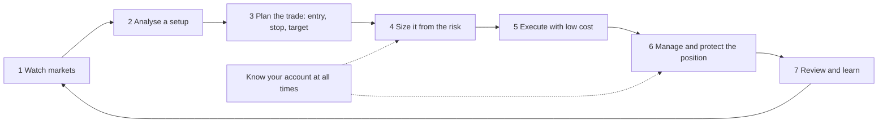

# Pod trading plugin: feature ideation from a trader's point of view

*Draft 1, 2026-11-26. Spec phase: ideation. Nothing here is decided yet; every feature has an ID so we can discuss it and decide on it one by one.*

**Sources.** [Pod beginner guide](file:///Users/sabpap/Workspace/Clients/Laurium/research/01-pod-network-beginner-guide.md), [read API reference](file:///Users/sabpap/Workspace/Clients/Laurium/exploration/02-read-api-reference.md) (checked live 2026-11-20), and the existing [exotic-ai tool](file:///Users/sabpap/Workspace/Clients/Laurium/exotic-ai/README.md).

**Scope.** Pod layer only: pod's REST API, JSON-RPC, WebSocket streams and the write path (signed transactions to pod's built-in contracts). Not the exotic app and not its research backend.

**Who uses the plugin.** An AI agent (the "ai-user", today the `pod-ai-user` Claude session) that trades on pod for a human owner, with a wallet the owner gives it.

---

## 1. How a professional trader works

A professional trader repeats one loop. Every feature below serves one step of it.

Two things run underneath the loop all the time: knowing exactly what the account holds and can afford, and the rules that stop one bad trade from ending the account.

## 2. What makes money and what loses it

**Most people who trade leveraged products lose money.** Brokers in Europe must publish this figure for their leveraged products, and it is typically 70% to 80% of retail accounts. They lose for the same few reasons:

1. **Positions too large.** At pod's 20x maximum, a 2.6% move against you liquidates the position.
2. **No stop-loss**, or a stop moved further away "to give it room".
3. **Costs eat the profit.** Taker fee 0.045% each way, the spread, slippage on thin books and funding payments add up, especially for frequent traders.
4. **Gaps.** On pod, a stock that is closed for the weekend trades on pod's internal price, which is fenced within about ±2.4% (20x) or ±4.8% (10x). On Monday the real price can jump straight through any stop.
5. **Over-trading and revenge trading** after a loss.

An AI agent has the same failure modes, plus two of its own: it can invent numbers, and it can act on stale data. So the plugin's first job is **survival and discipline**. Its second job is **edge**.

**Where an edge can come from on pod.** These are features of pod itself, so a pod-only plugin can use them:

| Edge | Why it exists on pod |
|---|---|
| **Funding carry** | Perps pay funding every half-second batch. When funding is high, the side being paid earns a steady income. Pod lists both a spot token (NVDAx) and a perp (NVDA) for the same asset, on the same margin account, so a position that is long spot and short perp is market-neutral and collects the funding |
| **Everyone's positions are public** | Any account's positions, leverage, liquidation price and profit can be read without a key. The agent can see how crowded a trade is and where large positions would be force-closed |
| **No speed race** | Orders are matched in batches at one price every 500 ms, so a slow agent is not beaten by faster bots inside a batch. Competition is on price, not speed |
| **Predictable weekend behaviour** | The internal price corridor and the Monday catch-up to the real price follow published rules |
| **Thin books on exotic markets** | Patient limit orders (makers) pay a lower fee (0.015% against 0.045%) and earn the spread. Impatient market orders pay for it |
| **Discipline at machine scale** | Code can enforce every rule on every trade, which most human traders fail to do |

**Design rules that follow from this:**

- **Code computes, the model decides.** Every number (margin, liquidation price, size, indicator) comes from code, never from the model's memory or mental arithmetic.
- **Fast reactions belong to code.** An LLM takes seconds to answer and pod settles every 500 ms. Stops, trailing stops, alerts and circuit breakers run in code; the model handles decisions on a scale of minutes to weeks. Scalping is out of scope.
- **Every position has a written plan and a stop** before it opens.
- **Limits live in code, before signing.** Pod's bot keys cannot be limited or revoked, so our layer is the only place a limit can exist.
- **Accepted is not filled.** Every action is followed until its real outcome is known.

---

## 3. Feature catalogue

Each table says what the feature is, what a trader uses it for, and where the data comes from:

- **Pod read**: pod's open read API (no key needed).
- **Pod write**: a signed transaction through pod's write path.
- **Computed**: our own code calculates it from pod data.
- **Outside pod**: needs data pod's API does not serve. These break the "pod API only" rule and are listed again in Section 5.

### A. Market data

| ID | Feature | What a trader uses it for | Source |
|---|---|---|---|
| A1 | **Market catalogue**: every market, spot or perp, status, max leverage, fees, price step, size step, minimum order value | Knowing what can be traded and the rules of each market | Pod read (`/v1/clob/markets`) |
| A2 | **Name resolver**: "nvidia", "sk hynix", "000660" all find the right market; perp preferred | The agent and the human speak in names, not 64-character ids | Computed |
| A3 | **Quote**: last price, mark price, oracle price, premium of mark over oracle, 24-hour change, high, low, volume, funding, open interest | The basic "where is it now" | Pod read (`/markets/stats`, `/orderbook`) |
| A4 | **Price history**: candles from 1 minute to 1 month, plus per-batch mark, oracle, funding and open interest | Charts, indicators, backtests | Pod read (`/candles`, `/solutions`) |
| A5 | **Market facts pod does not serve**: the real exchange behind each market, its opening hours and holidays, region and sector | Knowing when the real price moves and when gaps can happen | Outside pod (a static calendar file we maintain) |
| A6 | **Price mode flag**: is this market following the real price right now, or pod's internal price? | Weekend and overnight gap risk | Computed from A5 plus oracle staleness in `/solutions` |

### B. Market analysis

| ID | Feature | What a trader uses it for | Source |
|---|---|---|---|
| B1 | **Technical indicators**: moving averages, RSI, ATR (average daily range), Bollinger bands, VWAP, realised volatility, support and resistance levels, trend state | Finding entries and setting stops at sensible distances | Computed from A4 |
| B2 | **Liquidity analysis**: spread in basis points, money on offer within 0.5%, 1% and 2% of the price, buy/sell imbalance, "what would a $5,000 market order cost me in slippage", a liquidity score per market | Pod's exotic markets have thin books; trading size into them is expensive | Computed from `/orderbook` |
| B3 | **Funding and open-interest analysis**: funding now, average and as a yearly rate; funding trend; open interest change; "crowded trade" flag (high funding plus rising open interest) | Carry trades, avoiding expensive holds, spotting crowded positions | Computed from `/solutions`, `/markets/stats` |
| B4 | **Positioning intelligence**: discover active accounts, track large ones, add up the crowd's long and short exposure, map where large positions would be liquidated | Liquidation levels act as price magnets; crowd extremes often reverse | Pod read (any account), plus a collector we run, because the transaction list only keeps the last 1,000 |
| B5 | **Relative value**: correlation between markets, price ratio of two markets (Samsung against SK Hynix), spot token against perp basis | Pair trades and market-neutral trades | Computed |
| B6 | **Events**: earnings dates, central bank days, IPO news for pre-IPO markets | The biggest gaps come from scheduled events | Outside pod |
| B7 | **Market briefing**: one call answers "what happened since I last looked": biggest movers, funding extremes, volume spikes, my positions | The agent's morning routine | Computed (combines A–D) |

### C. Monitoring and alerts

Pod has no webhooks, email or push. Every alert needs a watcher process that we run, listening to pod's WebSocket streams or polling REST.

| ID | Feature | What a trader uses it for | Source |
|---|---|---|---|
| C1 | **Watchlists**: named lists of markets | Focus | Computed, stored locally |
| C2 | **Price alerts**: crosses a level, moves X% in a time window, new 24-hour high or low | Not having to stare at screens | Computed from streams |
| C3 | **Market activity alerts**: volume spike against the average, open-interest jump, funding past a threshold, spread widening, book thinning | Something unusual is happening | Computed from streams |
| C4 | **Account alerts**: order filled or partly filled, order refused (for example cancelled for lack of margin), stop or target fired, liquidation distance below X%, deposit credited, withdrawal ready or refused | Knowing what happened to my money | Pod read (`pod_orders`, `pod_positions`, `pod_withdrawals` streams) |
| C5 | **System alerts**: market about to be disabled, oracle stale (internal price mode starts), API lagging or failing, testnet reset, bot key about to expire | Knowing when the ground shifts | Computed |
| C6 | **Delivery**: inside the Claude session, a push notification to the owner's phone, or a daily digest | The human hears about what matters | Our layer |
| C7 | **Alert wakes the agent**: an alert can start an agent review under the risk rules, not only notify | Reacting without a human present | Our layer |

### D. Wallet and account awareness

| ID | Feature | What a trader uses it for | Source |
|---|---|---|---|
| D1 | **Wallet adapter**: one interface for every kind of wallet: address, what it can sign, sign a transaction, sign a permission slip. First adapters: the dev keystore we already have, a read-only "watch this address", and a pod bot key. Later: browser wallets, hardware wallets, email-login wallets (Privy) | Swap wallets without touching the trading code | Our layer |
| D2 | **Capability report**: "with this wallet I can read / trade / withdraw / transfer / deposit", and until when | The agent knows what it is allowed to do before it tries | Computed from D1 |
| D3 | **Balance sheet**: pod cash, withdrawable cash, spot tokens, equity, profit; gas on pod for the main key (bot keys pay none); USDC and ETH on the other chain for deposits | A complete picture of what is available | Pod read (`/balances`, `/positions`, `eth_getBalance`); the other chain is outside pod |
| D4 | **Margin dashboard**: account value, margin in use, maintenance margin, free margin, real leverage, how far the whole account can fall before liquidation and before the backstop takes everything | Pod uses cross margin: one pot backs every position, so risk is an account-level number | Computed from `/positions` and `/markets` |
| D5 | **Buying power per market**: the largest order I can place in NVDA now, after margin, size step and minimum order value | Avoids refused orders and over-sizing | Computed |
| D6 | **Positions view**: size, side, entry price, mark price, profit, return on margin, funding paid so far, liquidation price, distance to liquidation, whether a stop and target exist | The core status screen | Pod read plus computed |
| D7 | **Orders and triggers view**: open orders, armed stops and targets; flags positions with no stop and stops with no position | Catches unprotected positions | Pod read (`/orders`, `/triggers`) |
| D8 | **Bot key status**: which key the agent uses, when it expires, renewal reminder | Pod bot keys cannot be revoked, only left to expire | Our layer |
| D9 | **Account health**: free transaction numbers (nonces), pending transactions, frozen-account detection and recovery | One key can have only one pending transaction; a nonce clash freezes the account | Pod read (`/nonce-slots`, `pod_` methods) |
| D10 | **Money in transit**: deposits on the way, withdrawals pending, ready to claim or refused | Money is never "lost" between steps | Pod read (`/bridge/withdrawals`) |

### E. Pre-trade planning

| ID | Feature | What a trader uses it for | Source |
|---|---|---|---|
| E1 | **Order preview**: order value, fee, margin needed, account leverage after the trade, new liquidation price, expected fill price and slippage from the book, funding cost per day, free margin left | Seeing the consequences before signing | Computed (pod's TS SDK has a reference implementation) |
| E2 | **Position sizing**: by risk ("lose at most 1% of the account if the stop hits"), by volatility (stop at a multiple of ATR), or by fixed amount; capped by the risk rules and by liquidity | The single most important habit of professionals | Computed |
| E3 | **Trade plan**: thesis, entry, stop, targets, reward-to-risk ratio, what would prove the idea wrong, time limit. Stored and linked to the orders it creates | Forces a reason for every trade; makes review possible | Our layer |
| E4 | **Stress test**: the account after a ±X% move in one market, a move in a group of related markets together, a weekend gap past the corridor, or a funding spike | Cross margin means one shock can hit everything | Computed |
| E5 | **Cost check**: fees, spread, slippage and funding added up as "the price must move X% before this trade earns anything" | Kills trades whose edge is smaller than their cost | Computed |
| E6 | **Timing check**: is the real exchange open, is a weekend or holiday coming, is the market on internal price, is it a low-liquidity hour | Avoids opening big positions into a gap | Computed from A5, A6 |
| E7 | **Pre-trade checklist**: runs before every order: plan exists, stop set, size within risk, liquidity enough, rules pass | The discipline step, automated | Our layer (skill plus code) |

### F. Execution

| ID | Feature | What a trader uses it for | Source |
|---|---|---|---|
| F1 | **Basic orders**: limit, market, maker-only (post-only), reduce-only. All the fiddly parts handled: rounding to the price and size step, minimum order value, 18-decimal numbers, deadlines aligned to the half-second grid, transaction numbers | Placing orders without technical errors | Pod write (`submitOrder`) |
| F2 | **Bracket order**: entry, stop-loss and take-profit sent together in one batch, so the position is never unprotected | The professional default for every entry | Pod write (`submitBatch`) |
| F3 | **Edit and cancel**: change price or size, cancel one, all in a market, or all | Routine order handling | Pod write (`update`, `cancel`) |
| F4 | **Close helpers**: close a position, close a percentage, reverse it, close everything | Fast and safe exits | Pod write (reduce-only orders) |
| F5 | **Scaled orders**: a ladder of limit orders across a price range | Building or leaving a position gradually | Pod write (batch) |
| F6 | **Execution algorithms**: TWAP (slice a large order over time), iceberg (show only part of the size), chase (keep re-pricing a limit order at the best price up to a ceiling) | Trading size in thin books without moving the price | Pod write plus our watcher |
| F7 | **Outcome tracking**: follows each order from accepted to filled, partly filled or refused, with the reason in plain words; reports the average fill price and slippage against the preview | "Accepted" on pod does not mean "filled" | Pod read (`/orders`, `/fills`, streams) |
| F8 | **Dry run**: builds and shows the exact order without sending it | Checking before acting; testing | Computed |
| F9 | **Throughput**: batching and several bot keys, because one key can have only one pending transaction | Many orders in a short time | Our layer |

### G. Managing open positions

| ID | Feature | What a trader uses it for | Source |
|---|---|---|---|
| G1 | **Stop management**: move the stop to break-even, trailing stop (pod has none built in, so our watcher moves the stop trigger as the price moves) | Locking in profit | Pod write (`updateTrigger`) plus our watcher |
| G2 | **Scale out and time stop**: take part of the profit at each target; close if the idea has not worked within its time limit | Professional exit habits | Pod write plus watcher |
| G3 | **Funding watch**: warns when funding on a held position turns expensive | Slow losses from holding perps | Computed |
| G4 | **Our own early de-risking**: when the account nears liquidation, reduce positions in a controlled way first, or ask the owner for more money | Pod's liquidation is a market order on a thin book; reducing early is much cheaper | Pod write plus watcher |
| G5 | **Pre-weekend routine**: lower leverage, check every stop, report gap exposure before the real exchanges close | Gap protection | Skill plus computed |
| G6 | **Rebalance**: bring the portfolio back to target weights | Portfolio-style strategies | Pod write (batch) |

### H. Risk rules and safety

All of this runs in our code before anything is signed, because pod cannot limit bot keys itself.

| ID | Feature | What a trader uses it for | Source |
|---|---|---|---|
| H1 | **Risk policy file**: max real leverage; max position size per market and in total; allowed and blocked markets; max loss per day and week, after which trading stops; max orders per hour; max number of open positions; stop-loss required on every position; max slippage; minimum liquidity; no new positions in the X minutes before a weekend; max share of the account in one group of related markets | The owner's rules, enforced on every order | Our layer |
| H2 | **Autonomy levels**: advisor (reads and suggests, never trades), co-pilot (prepares orders, the human confirms each), autopilot (trades alone inside the policy, asks above set amounts) | Matching trust to experience | Our layer |
| H3 | **One gate for all writes**: every order passes one policy check in code; a Claude Code hook checks again before the tool runs | A rule in a prompt can be ignored; a rule in code cannot | Our layer |
| H4 | **Kill switch**: cancel every order and, if chosen, close every position, in one batch | The emergency stop pod does not have | Pod write (`submitBatch`) |
| H5 | **Circuit breakers**: stop trading on daily loss limit, stale data, API errors, stale oracle, disabled market, spread blowout, unexpected fills or repeated refusals | Halting when the situation is not normal | Computed |
| H6 | **Key safety**: the agent only ever holds a short-lived bot key; the main key stays with the owner; withdrawals and transfers always need the owner | A leaked bot key cannot steal, but it can lose the money through bad trades | Our layer |
| H7 | **Audit log**: for every decision, the data it used, the reasoning, the preview, the policy check, the signed transaction and the result; append-only | Accountability and debugging | Our layer |
| H8 | **Separate accounts per strategy**: one wallet per strategy or agent, funded by transfer from the main account | Cross margin means one bad trade can drain every position in the same account; separate accounts contain the damage | Pod write (`transfer`, main key) |

### I. Strategies and automation

| ID | Feature | What a trader uses it for | Source |
|---|---|---|---|
| I1 | **Playbooks** (as skills): trend following, breakout, mean reversion, funding carry, spot-against-perp basis, pair trades, market making with maker-only orders, weekend reconvergence | Tested recipes instead of improvisation | Skills plus computed |
| I2 | **Setup scanner**: runs each playbook's entry rules across all markets and lists candidates | Finding trades systematically | Computed |
| I3 | **Paper trading**: simulates orders against the live book and pod's auction rules, with a virtual account | Practising and evaluating strategies without risk; useful again on mainnet | Computed |
| I4 | **Backtesting**: replays a strategy on history, with fees, funding and slippage | Knowing whether a strategy ever worked. Caveat: testnet history is short and mostly bots, and testnet resets wipe it | Computed from A4 |
| I5 | **Scheduled strategies**: "every 4 hours run the scanner; if a setup appears, propose or place it under the policy" | Running without a human present | Our layer (watcher plus scheduled agent runs) |
| I6 | **Strategy scorecard**: performance per playbook | Dropping what does not work | Computed |

### J. Review and learning

| ID | Feature | What a trader uses it for | Source |
|---|---|---|---|
| J1 | **Trade journal**: each trade's plan, fills, result and notes, filled in automatically | The raw material for improvement | Pod read plus E3 |
| J2 | **Performance figures**: realised and unrealised profit, fees, funding, win rate, average win and loss, expected value per trade, worst drawdown, Sharpe ratio; per market and per strategy; equity curve | Knowing whether the agent is actually good | Computed from `/activity`, `/fills` |
| J3 | **Post-trade review**: was the plan followed, was the stop moved, was the size right; an AI critique | Finding repeated mistakes | Skill |
| J4 | **Daily and weekly report** for the owner | Keeping the human informed | Computed plus C6 |
| J5 | **Explain mode**: plain-language explanation of any number or order ("what 10x means for this order") | The owner is not a trader | Skill |
| J6 | **Export**: CSV of fills, fees and funding | Accounting and tax | Computed |

### K. Moving money

| ID | Feature | What a trader uses it for | Source |
|---|---|---|---|
| K1 | **Deposit**: approve and deposit on the other chain, then confirm the credit on pod | Funding the account | Outside pod (the other chain), credit seen through pod read |
| K2 | **Withdraw**: compute the withdrawable amount, withdraw (owner key only), follow it to "claimable" and "claimed", respect the whole-units rule | Taking profit out | Pod write plus pod read |
| K3 | **Transfer between own accounts** (owner key only) | Funding strategy accounts (H8) | Pod write |
| K4 | **Test money** from the testnet faucet | Development | Pod write (undocumented) |

---

## 4. Pod traps the plugin must handle

| Trap | What the plugin does |
|---|---|
| 20x maximum leverage: a 2.6% move liquidates | Policy caps real leverage far lower (H1); preview shows the liquidation distance (E1) |
| Cross margin: one pot for all positions | Account-level risk (D4), stress tests (E4), separate accounts (H8) |
| Weekend and overnight internal price, then a gap | Price mode flag (A6), timing check (E6), pre-weekend routine (G5) |
| Backstop takes the whole account below 2/3 of maintenance margin | Early de-risking (G4) |
| Accepted is not filled | Outcome tracking (F7) |
| Bot keys cannot be limited or revoked | Policy gate (H3), short expiries (D8, H6) |
| One pending transaction per key; nonce clash freezes the account | Nonce handling (F1, F9), health check (D9) |
| Numbers scaled by 10^18, in hex or decimal; times in micro- or plain seconds | Normalised once in the core library (already solved in exotic-core) |
| Fees: docs say zero, the live API says 0.015% / 0.045% | Always read fees from `/markets`, never assume |
| Thin books on exotic markets | Liquidity check (B2), maker orders, execution algorithms (F6) |
| Testnet resets wipe history and nonces | Reset detection (C5); journal kept locally (J1) |

## 5. What pod's API does not give us

The goal is to depend only on pod's API. These features need something else, so each needs a decision:

| Gap | Features affected | Options |
|---|---|---|
| Real exchange hours and holidays | A5, A6, E6, G5 | Ship a static calendar file with the plugin (not an outside service), or drop these features |
| News, earnings, events | B6 | Leave out; or let the agent use its own web search, clearly separated from pod data |
| Balances on the other chain (for deposits) | D3, K1 | Read the other chain's public RPC; or leave deposits to the human |
| Alerts and background work | C, G1, G4, F6, H5, I5 | A watcher process we run locally (no outside service needed) |
| Limits on bot keys | H | Our policy gate; ask pod whether protocol-level limits are planned |
| Market descriptions | A5 | Static file, or leave out |

## 6. What the plugin is made of

A first sketch, to be designed properly later:

- **Core library**: pod client, number normalisation, paging, calculations (margin, liquidation, sizing, indicators). exotic-core already does the read side in Python and could be reused or forked.
- **Wallet adapters** (D1) behind one interface.
- **Tools for the agent**: an MCP server and a CLI, grouped as read, analyse, plan, trade, account and admin.
- **Policy gate** (H3) that every write tool passes through.
- **Watcher**: a background process for streams, alerts, trailing stops and circuit breakers.
- **Skills**: how pod works, the risk policy, the pre-trade checklist, each playbook, the daily briefing, the post-trade review, explain mode.
- **Hooks**: a pre-tool check on every write tool; a session-start briefing.
- **Local state**: policy, watchlists, alerts, trade plans, journal, audit log.

## 7. A proposed order of work

A suggestion to discuss, not a decision:

| Phase | Goal | Features |
|---|---|---|
| 1. See | The agent knows the markets and its account, read-only | A1–A4, B1–B3, B7, D1–D7, D10, E1, J5 |
| 2. Act safely | The agent can trade under hard limits | F1–F4, F7, F8, E2, E3, E5, E7, H1–H4, H6, H7, D8, D9 |
| 3. Run continuously | Watching, alerting and protecting without a human present | C1–C7, G1–G5, H5, E4, E6, A5, A6, J1–J4 |
| 4. Edge | Strategies and deeper analysis | B4, B5, I1–I6, F5, F6, F9, H8, K1–K3, J6 |

## 8. Questions to settle in the next conversations

1. How much autonomy should the ai-user have at first: advisor, co-pilot or autopilot (H2)?
2. What time horizon: hours, days or weeks? This decides which playbooks and alerts matter.
3. Which gaps in Section 5 may we fill, and how?
4. Python (reusing exotic-core) or TypeScript (pod's official SDK has write helpers)?
5. Who sets the risk policy, and can the agent ever change it?
6. Testnet only for now: which features should wait for mainnet?
